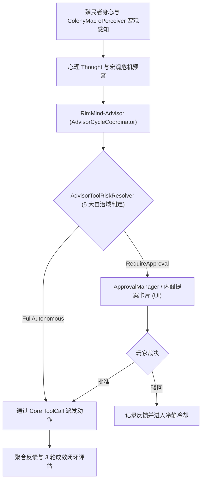

<div align="center">

# RimMind-Advisor 💡
### 专为 RimWorld 1.6 打造的殖民者自主建言、玩家审批与执行反馈闭环系统

[English](README.md) | **简体中文**

<p>
  <a href="https://rimworldgame.com/"></a>
  <a href="https://github.com/mcocdaa/RimWorld-RimMind-Mod-Core"></a>
  <a href="#"></a>
  <a href="LICENSE"></a>
</p>

<p><em>将 AI 心理感知沉淀为有理有据的战略建言，通过 5 大自治域分级策略、玩家审批与多轮反馈形成认知闭环。</em></p>

</div>

---

## 📖 模块概览

**RimMind-Advisor** 赋予殖民者根据当前身心状态、环境危机和全殖民地宏观预警提出建议的能力。通过 5 大自治领域策略路由，殖民者既可在授权域内自主执行紧急动作，也可将关键决策封装为结构化卡片交由玩家定夺。

### 核心特性
- **5 大自治域策略与 `AdvisorToolRiskResolver`**：支持在紧急生存（`EmergencySurvival`）、资源标记（`ResourceMarking`）、工作台清单（`WorktableBills`）、蓝图建造（`BlueprintPlacement`）与高风险操作（`HighRiskOperations`）5 大领域独立配置禁用、需审批或完全自主，优先于全局强制审批开关判定。
- **玩家审批流与生命周期清理（`ApprovalManager`）**：悬浮建议卡片清晰展示建言动机与拟执行工具，提供一键【批准】/【驳回】；小人离图或阵亡时自动触发 `CancelPendingForPawn` 清理悬空请求。
- **宏观态势感知与内阁会议（`ColonyMacroPerceiver` & `CabinetMeetingCoordinator`）**：定期扫描全殖民地粮食、医药、防务与士气危机，支持发起多工具联合内阁提案并在批准后直接执行 `ExecutionCallbacks`。
- **迷你胶囊自动收缩与 3 轮执行反馈闭环**：无待办时自动折叠为 `[Pending: 0]` 迷你胶囊，并持续追踪动作结果完成多轮反馈评估。

---

## 🎮 实机特性展示


*游戏内建议审批卡实机（附 `+1.2x ZOOM` 微距特写）：小人因连续食用营养膏产生情绪诉求并触发「傲娇女仆贝拉的绝食抗议」多行完整审批卡，支持一键【批准】/【驳回】，并与木屋餐厅气泡及左下角 `[RimMind-Dialogue]` 实时联动。*

---

## 🏛️ 系统架构与闭环流转



---

## 🛠️ 安装与加载顺序

```text
1. Harmony
2. Core (RimWorld 原版)
3. RimMind-Core
4. RimMind-Advisor
```

---

## 🧪 开发者测试指南

运行单元测试：

```powershell
dotnet test RimMind-Advisor/Tests/RimMindAdvisor.Tests.csproj -c Release
```

---

## 📜 开源协议

本项目采用 [MIT License](LICENSE) 开源许可证。
